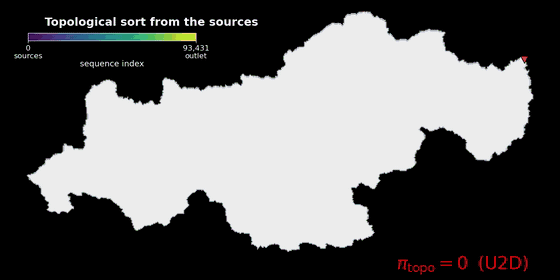
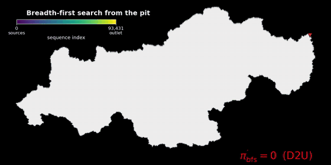
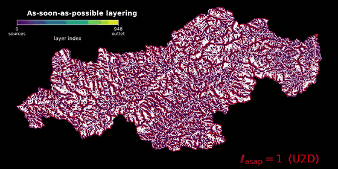
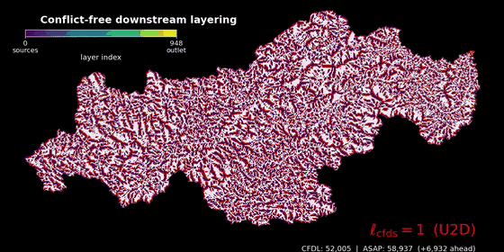
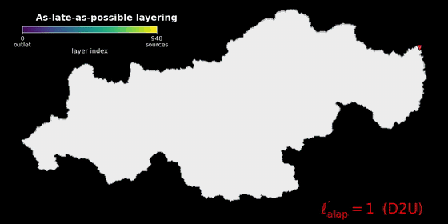
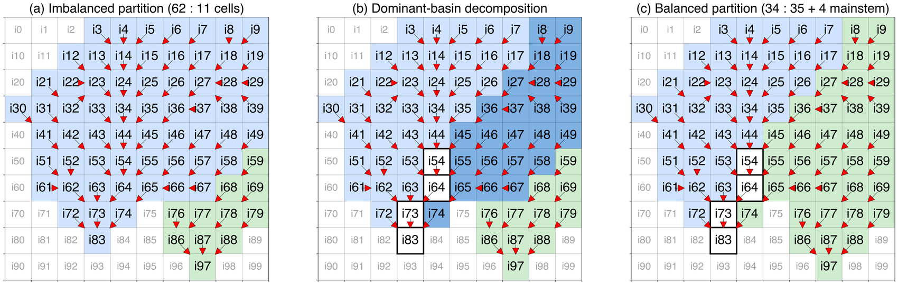
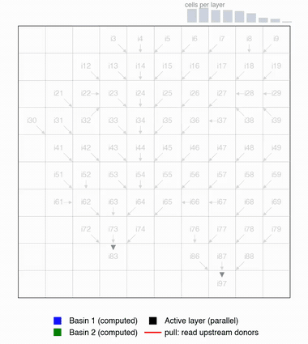
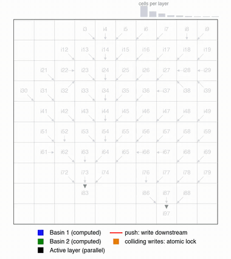
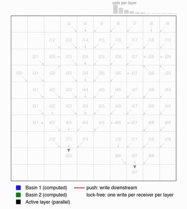

# FlowTopo

FlowTopo builds reusable orderings, parallel layerings and spatial partitions from a D8 flow-direction grid.

<table>
<tr><th align="center">topological sort from the sources<br><code>ordering="topo"</code></th><th align="center">breadth-first from the pit<br><code>ordering="bfs"</code></th><th align="center">depth-first from the pit<br><code>ordering="dfs"</code></th></tr>
<tr><td align="center"><a href="https://hellolulujiang.github.io/flowtopo/media/seq_topo.mp4"></a></td><td align="center"><a href="https://hellolulujiang.github.io/flowtopo/media/seq_bfs.mp4"></a></td><td align="center"><a href="https://hellolulujiang.github.io/flowtopo/media/seq_dfs.mp4"></a></td></tr>
<tr><td valign="top" align="center">a cell is appended once all its donors are done</td><td valign="top" align="center">cells in order of hop count from the pit</td><td valign="top" align="center">one tributary subtree at a time; best cache locality</td></tr>
</table>

*Three serial orderings visit every cell once while respecting the flow dependencies.*

## Install

```sh
git clone https://github.com/hellolulujiang/flowtopo.git
cd flowtopo
pip install -e ".[speed]"
```

Python 3.10 or newer. The `speed` extra enables threaded kernels.

## Quick start

```python
import flowtopo

topo = flowtopo.FlowTopo.from_raster("data/dir_example.tif")
upa = topo.upstream_area(ordering="dfs")  # km²
upa_grid = topo.to_2d(upa)
```

The bundled MERIT Hydro basin has 93,432 valid cells. [Input requirements](docs/user-guide.md#example-data).

## Structures and propagation

### Many threads: which cells together?

*Three parallel layerings. Layers run in order; the cells of one layer run at the same time.*

<table>
<tr><th align="center">as-soon-as-possible<br><code>layering="asap"</code></th><th align="center">conflict-free downstream<br><code>layering="cfds"</code></th><th align="center">as-late-as-possible<br><code>layering="alap"</code></th></tr>
<tr><td align="center"><a href="https://hellolulujiang.github.io/flowtopo/media/lyr_asap.mp4"></a></td><td align="center"><a href="https://hellolulujiang.github.io/flowtopo/media/lyr_cfds.mp4"></a></td><td align="center"><a href="https://hellolulujiang.github.io/flowtopo/media/lyr_alap.mp4"></a></td></tr>
<tr><td valign="top" align="center">every cell in the earliest layer its donors allow</td><td valign="top" align="center">as-soon-as-possible, plus: no two cells in a layer share a receiver</td><td valign="top" align="center">every cell as late as the longest flow path allows; the most evenly filled layers in practice</td></tr>
</table>

### Several processors: which cells where?

<p align="center"><a href="docs/media/partition_schematic.png"></a></p>

<p align="center"><i>Two basins onto two subregions: (a) whole basins, unbalanced; (b) the dominant basin cut along its mainstem, a tributary subtree moved; (c) balanced.</i></p>

<table>
<tr><th align="center" width="50%">basin-level<br><code>level="basin"</code></th><th align="center" width="50%">subbasin-level<br><code>level="subbasin"</code></th></tr>
<tr><td align="center">whole basins go to subregions; a dominant basin cannot be balanced</td><td align="center">the basins that keep the parts from balancing, usually the dominant one, are opened along their mainstems; their tributary subtrees balance the load, and the held-back mainstem section runs in a separate stage</td></tr>
</table>

### At a confluence: how does a value reach the receiver?

*Three propagation manners. The structure decides when a cell runs; the manner decides who writes the result.*

<table>
<tr><th align="center">pull<br><code>manner="pull"</code></th><th align="center">atomic push<br><code>manner="atomic_push"</code></th><th align="center">push<br><code>manner="push"</code></th></tr>
<tr><td align="center"><a href="https://hellolulujiang.github.io/flowtopo/media/manner_pull.mp4"></a></td><td align="center"><a href="https://hellolulujiang.github.io/flowtopo/media/manner_atomic_push.mp4"></a></td><td align="center"><a href="https://hellolulujiang.github.io/flowtopo/media/manner_push.mp4"></a></td></tr>
<tr><td valign="top" align="center">each receiver reads its donors and writes only itself; needs the donor table</td><td valign="top" align="center">donors write through atomics; correct, but float sums are not reproducible</td><td valign="top" align="center">donors write directly; deterministic, no locks; safe only under <code>cfds</code></td></tr>
</table>

## Data products

[FullTopo v1.1](https://fullhydro.org/downloads/merit-hydro-v1.0.1-90m/fullbasin/fulltopo/v1.1/) provides saved structures for the 90 MERIT Hydro regions of FullDivide v1.1. [Contents and use](docs/user-guide.md#global-products).

## Documentation

[User guide](docs/user-guide.md) · [Methods and provenance](docs/methods.md) · [Notebook](examples/quickstart.ipynb) · [Video](https://youtu.be/tE5K2wM3TTY) · [Animations](https://hellolulujiang.github.io/flowtopo/) · [FullHydro tools](https://fullhydro.org/tools/flowtopo/)

[Tests](docs/user-guide.md#tests) · [](https://github.com/hellolulujiang/flowtopo/actions/workflows/tests.yml)

## Citing

Cite this repository with the release used and downloaded products by version. Code: FlowTopo code 1.1.3, [10.5281/zenodo.23732152](https://doi.org/10.5281/zenodo.23732152). Paper: *FlowTopo v1.0: a reusable computational foundation for hyperresolution hydrology on the global 90 m MERIT Hydro drainage network* (Jiang et al., submitted to *Geoscientific Model Development*); it describes version 1.0, archived with its code at [10.5281/zenodo.22227621](https://doi.org/10.5281/zenodo.22227621).

## Acknowledgements

MERIT Hydro ([Yamazaki et al., 2019](https://doi.org/10.1029/2019WR024873)) supplies the example grid. Foundational conventions follow [pyflwdir](https://github.com/Deltares/pyflwdir) (D. Eilander, Deltares; MIT); see [provenance](docs/methods.md#provenance).

## Licence

MIT; see [LICENSE](LICENSE). The bundled MERIT Hydro excerpt retains its terms, CC BY-NC 4.0 or ODbL 1.0; see [DATA_NOTICE.md](DATA_NOTICE.md).
